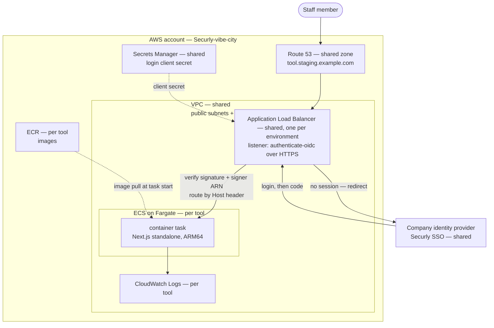
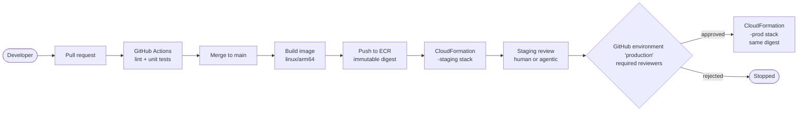
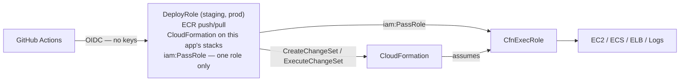

# Internal Tool Platform — Architecture and Access Requirements

**Scope:** the GitHub template that every internal tool is built from, and the AWS
account it deploys into (`Securly-vibe-city`, `014574285253`).

**Status:** the architecture is agreed and implementation is at Phase 1 of 5. **§3 lists
the three assumptions it rests on and §4 the three answers we need.** §7 describes the
permission gap that blocks the first real deploy.

---

## 1. Summary

Every internal tool is the same shape:

- A container running on **ECS Fargate**, in private subnets.
- Behind a **shared Application Load Balancer** that requires staff to log in through
  the **company identity provider** before any request reaches the container.
- **All infrastructure defined in CloudFormation**, deployed automatically from GitHub.
- **No long-lived AWS credentials anywhere.** GitHub authenticates to AWS with
  short-lived OIDC tokens.

A new tool is created by copying the template repository. It brings its own code,
image, stack and pipeline; it shares the network, the load balancer, the DNS zone, the
identity provider and the login secret with every other tool.

---

## 2. Architecture

### 2.1 Component map

| Component | Role | Shared or per tool |
|---|---|---|
| GitHub repository | Holds the tool's code, templates and pipelines | Per tool |
| GitHub Actions | Builds the image and deploys it | Per tool |
| ECR | Stores the tool's images | Per tool |
| ECS on Fargate | Runs the tool's containers | Per tool |
| Application Load Balancer | Requires login and routes traffic to the right tool | Shared, one per environment |
| Company identity provider | Holds staff accounts and handles login | Shared |
| Route 53 | Gives each tool its web address | Shared zone, one record per tool |
| Secrets Manager | Stores the login client secret | Shared |
| CloudWatch Logs | Stores each tool's logs | Per tool |
| VPC and subnets | Private network the tools run in | Shared |

### 2.2 Request path

A staff member opens the tool's address, e.g. `tool-name.staging.example.com`:

1. **Route 53** resolves the name to the shared load balancer.
2. The **load balancer** checks for a valid login session. Without one, it redirects
   the browser to the **company login page**.
3. After login the load balancer forwards the request to the tool's target group and
   containers, **attaching signed headers describing who the user is**.
4. The tool reads and **cryptographically verifies** those headers. It trusts nothing
   that is not signature-verified.
5. Containers sit in **private subnets** and accept traffic only from the load
   balancer.

**What the load balancer actually sends.** After `authenticate-oidc` succeeds the load
balancer adds three headers. Only the first is trustworthy:

| Header | Signed? | Contains |
|---|---|---|
| `x-amzn-oidc-data` | **yes**, ES256 JWT | user claims |
| `x-amzn-oidc-accesstoken` | no, plaintext | identity provider access token |
| `x-amzn-oidc-identity` | no, plaintext | `sub` |

AWS states the latter two "are unsigned and cannot be independently verified". The
template therefore ignores them, and a test asserts that a forged
`x-amzn-oidc-identity` alone authenticates nobody.

Two ALB-specific traps the template already handles:

- **Expiry lives in the JWT header, not the payload.** Every standard JWT library
  validates `exp` from the payload, finds nothing, and passes — so a naive
  `jwtVerify()` accepts expired tokens. Expiry is checked by hand.
- **The header carries `signer`, the ARN of the ALB that minted the token.** A valid
  signature only proves that *some* ALB signed it, and any AWS account can run one.
  The signer must equal the expected ALB ARN, or the token is refused.

### 2.3 Deploy path

The image is **built once and promoted by digest**. Production never rebuilds, so the
artifact reviewed on staging is byte-for-byte the artifact that runs in production.

### 2.4 How the "no long-lived keys" rule is enforced

The deploy role cannot touch EC2, ECS or ELB itself. It can only start a
CloudFormation change set and hand it one role. The real resource permissions live in
`CfnExecRole`, which **nobody but CloudFormation can assume**. Blast radius of a
compromised CI token is therefore: push an image, and change this one app's stacks.

### 2.5 Environments

Staging and production are **separate CloudFormation stacks with separate load
balancers, addresses and deploy roles**. The production deploy role trusts **only**
the GitHub `production` environment, and that environment has required reviewers — so
the human approval in GitHub is what actually gates access to production credentials.

### 2.6 Security properties

- Every tool requires company login. There is no public access — **except the health
  check path** (see §8.1).
- All traffic uses HTTPS. `authenticate-oidc` only works on an HTTPS listener, so a
  certificate is mandatory, not optional.
- No long-lived AWS keys are stored anywhere. GitHub signs in with temporary tokens.
- Secrets live in Secrets Manager, never in code.
- Each tool's permissions are limited to what it needs.

---

## 3. Assumptions

The architecture was described as a target, without saying how resources are shared or
what the identity provider supports. Three assumptions make it concrete. Each one
changes the design if it turns out to be wrong, so they are worth confirming before
Phase 2 is written.

**1. The load balancer is shared, not one per tool.** One per environment, routing to
each tool by Host header. A shared DNS zone, a wildcard certificate and a single login
client secret come with it, so a new tool adds only a service, a listener rule and a
record.
*If it is per tool instead:* each tool owns its listener and certificate (roughly
$16/month more per tool), but its stack becomes fully self-contained.

**2. The identity provider speaks OIDC.** This is what `authenticate-oidc` requires.
*If it is SAML-only instead:* `authenticate-saml` uses different headers, and the
identity verification already built and tested has to be rewritten.

**3. Shared resources are created once, by a platform stack owned by an admin**, and
per-tool stacks only reference them.
*If each tool creates its own instead:* every tool's stack has to request `acm:*`,
`route53:*` and `secretsmanager:*`, which contradicts "each tool's permissions are
limited to what it needs".

---

## 4. Questions for the platform team

Three answers unblock most of the remaining work.

1. **Is the load balancer shared across tools, or one per tool?** If shared, who owns
   changes to the shared listener, given that every tool's deploy touches it?
2. **Which domains will staging and production use**, and does a hosted zone and
   wildcard certificate already exist in this account? Login cannot be enabled without
   HTTPS, so a certificate is a prerequisite rather than a later step.
3. **Who runs the one-time bootstrap** (§7) — an admin, or the team with the two small
   permission additions in Option A? And who owns the platform stack afterwards?

---

## 5. Implementation status

Identity verification — the only part of the design that is hard to get right — is
complete and tested. The infrastructure for phases 2–5 is written and lints clean, but
has not yet been deployed end to end.

| # | Phase | State |
|---|---|---|
| 1 | Sample app + Dockerfile | **Complete** — 27 tests, image builds and serves |
| 2 | AWS infra (ECS, ALB, ACM) | Written — `infra/app/` |
| 3 | OIDC on the ALB listener | Written — `infra/app/app.yaml` |
| 4 | GitHub → AWS auto-deploy | Written — `.github/workflows/deploy.yml` |
| 5 | Review gate + prod promotion | Written — `production` environment in `deploy.yml` |

The infrastructure is split into two templates, as agreed with Ops: a security
template (`infra/security/security.yaml`: roles, permissions boundary, ECR, secrets)
that Ops reviews and deploys rarely, and an app template (`infra/app/`) the team
deploys freely. See `infra/README.md` for the model, the baseline and setup steps.

---

## 6. Current access

The role in `Securly-vibe-city` is `AWSReservedSSO_vibe-city-dev_8509c5f30aaf5096`,
reached through IAM Identity Center as profile `vibe-city`.

Its inline policy allows exactly:

| Statement | Effect |
|---|---|
| `CloudFormationStackOps` | Create/update/delete stacks and change sets on `*` |
| `ChangesOnlyThroughCloudFormation` | `ec2:*`, `ecs:*`, `elasticloadbalancing:*`, `logs:*`, `s3:*` — **only** when `aws:CalledVia` is `cloudformation.amazonaws.com` |
| `ConsoleTemplateUploads` | S3 access restricted to `cf-templates-*` |
| `NoLongLivedIdentities` | **Deny** `iam:CreateUser`, `iam:CreateAccessKey`, `iam:CreateLoginProfile` |

Plus the AWS managed `ReadOnlyAccess` policy, which is why everything can be inspected.

**How it works:** CloudFormation runs with the caller's identity, not a service role.
Because the resource permissions are conditional on `aws:CalledVia`, direct console and
CLI changes are blocked while stack changes are allowed. That is a deliberate and
correct design for changes to *resources*.

**Why it is not enough for this architecture** — the permissions that matter are
attached to a human SSO role, and **GitHub Actions cannot assume an SSO role**. CI must
use its own role assumed via OIDC. So this policy is not a starting point that CI can
inherit; the deploy roles have to exist separately regardless.

---

## 7. The gap

Four capabilities are missing, and each one stops the first deploy at a specific step.

| Missing | Consequence |
|---|---|
| **ECR** (`ecr:CreateRepository`, `ecr:PutImage`) | `ecr` is not in the CloudFormation allowlist, so a stack cannot create the repository either. There is nowhere to put the image, and there is no image to deploy. **Fails first.** |
| **`iam:CreateRole`** | Cannot create the task execution role, the task role, the CloudFormation execution role, or the GitHub deploy roles. |
| **`iam:PassRole`** | Even with roles created by hand, an ECS task definition cannot reference one. |
| **`iam:CreateServiceLinkedRole`** for `ecs.amazonaws.com` and `elasticloadbalancing.amazonaws.com` | Implicitly denied. The account does not have these roles yet, so **the first ECS cluster and the first load balancer fail even though `ecs:*` and `elasticloadbalancing:*` are allowed.** |
| **ACM** | No certificate means no HTTPS, and `authenticate-oidc` cannot be attached to an HTTP-only listener. So the central SSO requirement of §2.2 cannot be met. |
| **Route 53** | Cannot create the per-tool DNS record. |
| **Secrets Manager** | Cannot store the shared login client secret. |

Two conclusions follow:

1. **The one-time bootstrap must be run by an admin.** It creates the roles, the ECR
   repository and the OIDC trust, and only then can every later change flow through CI.
2. **Extending `vibe-city-dev` is the wrong fix.** The `CalledVia` model requires the
   deploying identity to permanently hold a blanket resource allowlist — and that list
   has to keep growing as tools need more services (ACM, ECR, Route 53, Secrets
   Manager, and whatever comes next). §2.4's role-separation model is strictly narrower
   and is the only shape that works with GitHub OIDC.

---

## 8. Corrections to the architecture as originally written

Four points where the written description does not match how the system has to behave.

### 8.1 "There is no public access" cannot be absolute

The load balancer health check follows no redirects and carries no session cookie. If
`/api/health` sits behind `authenticate-oidc`, the load balancer receives a 302, marks
the target unhealthy, and removes **every** task from service — a self-inflicted
outage. The health path must be forwarded by a higher-priority listener rule that skips
authentication, ahead of the catch-all rule that authenticates. Everything else remains
login-only.

### 8.2 The tool never handles the login client secret

The client secret is held by the **load balancer's** OIDC configuration, not by the
application. The tool only ever receives the signed identity header. So Secrets Manager
is shared platform configuration, not part of any tool's code or configuration surface,
and per-tool stacks have no reason to request `secretsmanager:*` permissions.

### 8.3 Shared versus per-tool determines the template's shape

The technical consequence of assumption 1 in §3: with a shared load balancer, the app
stack is no longer self-contained. The network, the load balancer, the certificate and
the zone must already exist, and the per-tool stack only references them and adds a
Host-header rule. Which resources are shared is therefore a prerequisite for writing
Phase 2, not a detail to settle later.

### 8.4 The image is ARM64

The image is built on an Apple Silicon host with no platform pin, so it is
`linux/arm64`. The Fargate task definition must therefore specify
`cpuArchitecture: ARM64`. A mismatch surfaces as an exec format error when the task
starts, not at build time. **CI builds on x86_64 runners unless told otherwise**, so
the pipeline must pin `--platform linux/arm64` (buildx with emulation, or an ARM64
runner) or local and CI images will silently disagree.

---

## 9. Options

**Option A — admin runs the bootstrap once; `vibe-city-dev` stays narrow. (Recommended)**

An admin runs `infra/security/security.yaml` with admin credentials, once per tool, and
subsequently every change flows through GitHub Actions → CloudFormation. The team's
own permissions stay read-only plus CloudFormation. Requires two small additions if the
bootstrap is to be run by the team instead of an admin: `iam:PassRole` limited to the
two task roles with `iam:PassedToService = ecs-tasks.amazonaws.com`, and ECR push/pull
on that one repository.

*Why recommended:* preserves the account's stated security rule, gives CI a way to
deploy without keys, and keeps each tool's permissions limited to what it needs.

**Option B — widen `vibe-city-dev` with `ecr:*`, `acm:*`, `iam:CreateRole`, `iam:PassRole`.**

Simplest to describe, and rejects the account's central rule: `iam:CreateRole` plus
`iam:PassRole` is effectively full account access, because a role can be created with
any policy and passed to any service. Expect this to be refused, and reasonably so. It
also does not solve CI, since GitHub still cannot assume an SSO role.

**Option C — prove the design in a separate sandbox account first. (Recommended alongside A)**

Rehearse the entire path — bootstrap, staging stack, pipeline, review gate, production
promotion — in an account where the team already has admin. Every input is a
parameter (account, region, repository, domain), so moving to `Securly-vibe-city` is a
re-run with different values and **no code changes**. This produces a working
demonstration instead of a plan, and de-risks the one-time admin step.

**Option D — introduce a shared platform stack.**

If assumption 3 holds and the load balancer, zone, certificate and login secret are
shared across many tools, they should be created once by a platform stack owned by an
admin, and per-tool stacks should reference them by export. This is what keeps the
per-tool `CfnExecRole` narrow: it never needs `acm:*`, `route53:*` or
`secretsmanager:*`.

Option D is not in conflict with A, B or C — it is a decision about where the shared
resources are created, and it should be settled before the staging stack is written.
Question 3 asks who would own it.

---

## 10. What can proceed without any new permissions

- Publish the repository to GitHub and mark it as a template (there is no remote yet).
- Write the CI pipeline: pull-request checks (lint, tests, image build), then build →
  push by digest → deploy staging on merge, with production gated by a GitHub
  environment that has required reviewers.
- Write the `-staging` / `-prod` application stack, including the health-check listener
  rule from §8.1.
- Extend `CfnExecRole` to match the final component list.
- Rehearse everything in the sandbox account (Option C).

## 11. What is blocked until §7 is resolved

- Creating the ECR repository, the IAM roles and the GitHub OIDC trust.
- Any real deployment into `Securly-vibe-city`: the first load balancer, the first ECS
  cluster, the certificate, the DNS record.
- Consequently, phases 2 through 5 of the template.

The three answers in §4 and one admin action (§7, Option A) unblock all of it. The
pipeline, application stack and review gate can meanwhile be built and demonstrated in
a sandbox account (§10, Option C).
